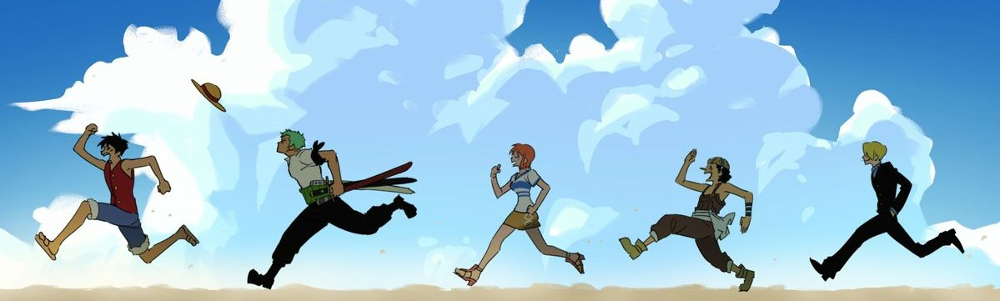
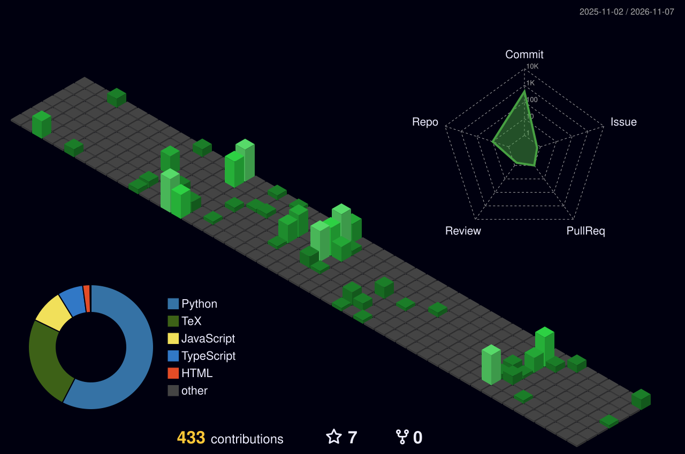

  

# Yassin Asermouh

Researcher and freelancer. I study data science and work on artificial intelligence.

I am open to collaboration. [Email](mailto:asermouhyassin@gmail.com) or [LinkedIn](https://www.linkedin.com/in/yassin-asermouh-984aa8249/).

**Current interests**

- Causal inference
- Data engineering (Apache tools, HDFS)
- Systems design
- Neuroplasticity
- Medical AI, specifically 3D segmentation (U-Net, SegResNet)
- Imitating human learning in RL-free models

 

## Selected work

- [BioRL](https://github.com/Thedarkiin/Neurobiological_sac). A brain-inspired replay buffer for reinforcement learning. Novelty, strengthening and forgetting decide which experiences an agent keeps, and the buffer plugs into Soft Actor-Critic without changing anything else.
- [Physics-informed wind forecasting](https://github.com/Thedarkiin/physics-informed-wind-transformer). A Transformer for 24-hour wind power forecasting that builds aerodynamic laws into its features and adds a loss designed to anticipate sudden power ramps.
- [AI Trader](https://github.com/Thedarkiin/Trader). A multi-agent paper-trading desk. LLM specialists debate each trade, while plain Python owns every calculation and every decision.
- [Telecom churn prediction](https://github.com/Thedarkiin/Telecom-churn-prediction). A retention system in a Flask app that predicts customer churn and points to its causal features.

## Other projects

- [Sail the Ocean](https://github.com/Thedarkiin/Onepiece). A 3D sailing experience in the browser, built with Three.js, React and custom WebGL shaders. [Try it live](https://thedarkiin.github.io/Onepiece/).
- [Foxy Login Screen](https://github.com/Thedarkiin/animated_fox_loginpage). A single-file login page whose fox mascot reacts to what you type, covering her eyes during password entry.
- [Movie Shelf](https://github.com/Thedarkiin/Movie-shelf-React). A React and Redux app for browsing films through the TMDb API and keeping a personal list.
- [Voice recognition with a GMM](https://github.com/Thedarkiin/gaussian_mixture_model). A Gaussian mixture model trained to tell whether a voice is mine.

## Tools

<table>
  <tr>
    <td align="center" width="88"> Python</td>
    <td align="center" width="88"> PyTorch</td>
    <td align="center" width="88"> TensorFlow</td>
    <td align="center" width="88"> Pandas</td>
  </tr>
  <tr>
    <td align="center" width="88"> React</td>
    <td align="center" width="88"> TypeScript</td>
    <td align="center" width="88"> Tailwind</td>
    <td align="center" width="88"> Figma</td>
  </tr>
</table>

 

<picture>
  <source media="(prefers-color-scheme: dark)" srcset="https://raw.githubusercontent.com/Thedarkiin/Thedarkiin/output/profile-night-green.svg"/>
  <source media="(prefers-color-scheme: light)" srcset="https://raw.githubusercontent.com/Thedarkiin/Thedarkiin/output/profile-green-animate.svg"/>
  
</picture>

<picture>
  <source media="(prefers-color-scheme: dark)" srcset="https://raw.githubusercontent.com/Thedarkiin/Thedarkiin/output/github-contribution-grid-snake-dark.svg"/>
  <source media="(prefers-color-scheme: light)" srcset="https://raw.githubusercontent.com/Thedarkiin/Thedarkiin/output/github-contribution-grid-snake.svg"/>
  
</picture>
