<picture>
  <source media="(prefers-color-scheme: dark)" srcset="assets/card-dark.svg"/>
  <source media="(prefers-color-scheme: light)" srcset="assets/card-light.svg"/>
  
</picture>

  

Data Science student, though I think of myself more as an interdisciplinary researcher or a curious engineer. 
Open to collaboration if you're working on something interesting, hit me up.

  

  

<picture>
  <source media="(prefers-color-scheme: dark)" srcset="https://raw.githubusercontent.com/Thedarkiin/Thedarkiin/output/github-contribution-grid-snake-dark.svg"/>
  <source media="(prefers-color-scheme: light)" srcset="https://raw.githubusercontent.com/Thedarkiin/Thedarkiin/output/github-contribution-grid-snake.svg"/>
  
</picture>

